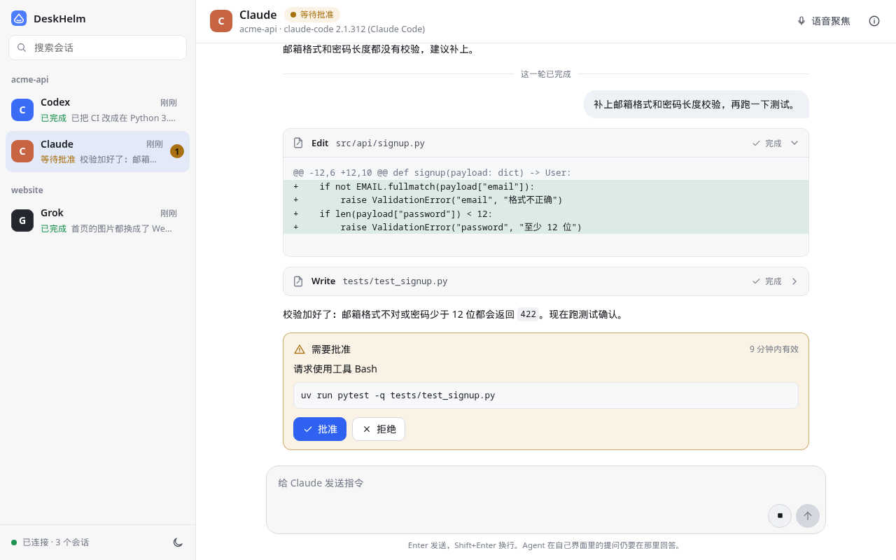
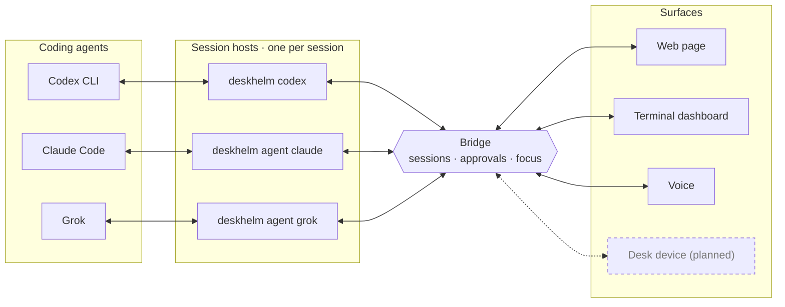

# DeskHelm

**A local-first control surface for coding agents.**

DeskHelm shows what every coding agent on your computer is doing and lets you
answer it from one place: approve or reject a command, stop a turn, or send
the next prompt, from a browser page, a terminal dashboard, or your voice.
Your prompts and code never leave your machine. A desk device with physical
controls is the long-term goal.

<picture>
  <source media="(prefers-color-scheme: dark)" srcset="docs/images/web-page-dark.png">
  
</picture>

## How It Works



- **Session hosts** run each agent in your project directory and translate
  its own protocol (Codex app-server, Claude Code stream-json, or ACP) into
  facts. Codex keeps its TUI in your terminal; DeskHelm proxies its approvals.
- **The Bridge** is one local Unix socket that knows every session's state,
  its open approvals, and which session voice talks to. It runs no agent,
  keeps only a short recent window in memory, and can restart without
  stopping an agent.
- **Surfaces** read that state and send commands. Only the page and the
  dashboard see command lines and output; voice hears fixed notices.

## Quick Start

You need Linux, Python 3.11 or newer, [uv](https://docs.astral.sh/uv/), and
the agent CLIs you use: `codex`, `claude`, or `grok`.

1. Install DeskHelm from a clone and put `deskhelm` on your path:

   ```bash
   git clone https://github.com/cuihuir/deskhelm.git && cd deskhelm
   uv sync --extra ptt --locked
   ln -s "$PWD/tools/deskhelm-user-launcher" ~/.local/bin/deskhelm
   ```

2. In your project directory, start an agent session. The first session
   starts the Bridge in the background.

   ```bash
   deskhelm codex           # Codex in this terminal
   deskhelm agent claude    # or Claude Code; deskhelm agent grok for Grok
   deskhelm simulate        # or a demo session that needs no agent
   ```

3. In another terminal, serve the page and open the link it prints, once per
   browser:

   ```bash
   deskhelm web             # prints http://127.0.0.1:8766/?token=...
   ```

On the page you read replies and tool output, approve or reject what an
agent asks after seeing the command or files it would touch, answer a Codex
question by picking an option or writing your own, send the next prompt,
stop a turn, and choose a Codex model.

| Command | What it does |
|---|---|
| `deskhelm dashboard` | The same in a terminal: `j`/`k` move, `a`/`r` approve or reject, `i` interrupts, `f` focuses, `q` quits |
| `deskhelm sessions` | List sessions and their pending approvals |
| `deskhelm codex --check` | Check Codex and the Bridge without starting a session |
| `deskhelm codex --voice` | Also attach voice: hold right Alt to talk to the session; `批准` or `拒绝` answers its one pending approval |

Voice is optional and runs local models from a separate environment:
`(cd voice/runtime && uv sync --locked --python 3.12)`, then set the model
and audio settings described in [`bridge/README.md`](bridge/README.md#voice-host).

## Status

DeskHelm 0.3.0 runs from a source checkout on Linux and needs no hardware.
It was checked live with Codex CLI 0.166.0, Claude Code 2.1.312, and Grok
1.0.60. The Codex integration uses Codex's experimental app-server and is
alpha. Hardware, firmware, and the device transport stay exploratory until
an ADR records them.

## Repository

| Path | Purpose |
|---|---|
| [`bridge/`](bridge/) | The Bridge, session hosts, surfaces, and voice host |
| [`adapters/`](adapters/) | Drivers for Codex, Claude Code, and ACP agents such as Grok |
| [`protocol/`](protocol/) | The local protocol v2 specification |
| [`voice/`](voice/) | The voice gateway: push-to-talk, ASR, TTS, and benchmarks |
| [`docs/`](docs/) | Research, architecture, product documents, and decisions |
| [`tests/`](tests/) | Cross-component, compatibility, and replay tests |
| [`tools/`](tools/) | The launcher, the PTY relay, the page check, and voice tools |
| [`hardware/`](hardware/), [`firmware/`](firmware/), [`configurator/`](configurator/) | Future device work |

## Development

- [`bridge/README.md`](bridge/README.md) and
  [`adapters/README.md`](adapters/README.md): the components and their
  commands.
- [`protocol/deskhelm-v2.md`](protocol/deskhelm-v2.md): the wire contract.
- [`docs/decisions/`](docs/decisions/): decisions recorded before
  implementation spreads across components.
- [`Handoff.md`](Handoff.md): the current state, risks, and next steps.

Before committing, run:

```bash
git diff --check
uv run --project voice/runtime --locked --no-sync python -m unittest discover -s tests -v
```

## Principles

1. **Agent-agnostic**: no single coding agent owns the experience.
2. **Local-first**: controlling agents must not require uploading private
   work.
3. **Open interfaces**: integrations communicate through documented events
   and protocols.
4. **Safe controls**: a consequential action shows its target and state
   before you take it.
5. **Great hardware**: a new physical computing product, not a terminal
   shortcut accessory.
