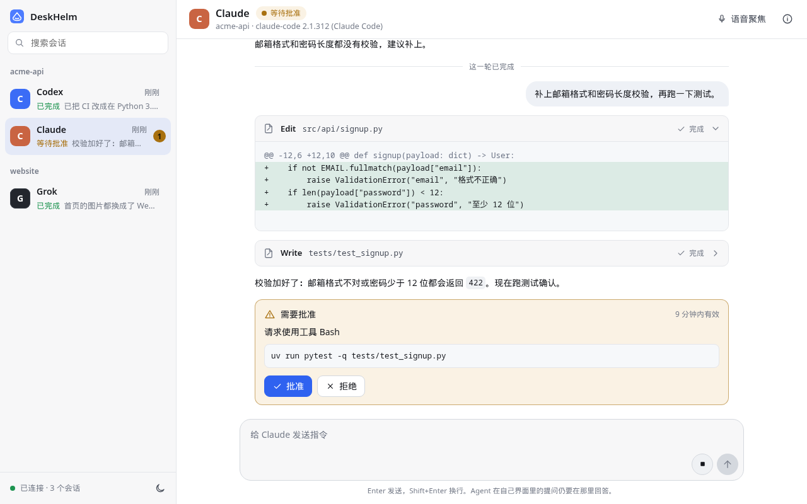
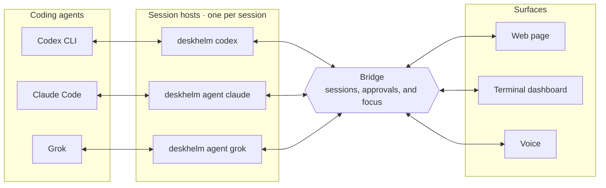

# DeskHelm

**A local-first control surface for coding agents.**

DeskHelm brings Codex, Claude Code, and Grok sessions together on Linux. Use
the browser to follow replies and tool output, review approvals, answer Codex
questions, send prompts, or interrupt a turn. Codex still runs in its native
terminal UI. A terminal dashboard and optional local push-to-talk give you
other ways to act on a session.

**Development has ended at [v0.3.0](https://github.com/cuihuir/deskhelm/releases/tag/v0.3.0).**
This release runs from a source checkout on Linux. The hardware controller
and mobile remote access stayed at the research stage.

<picture>
  <source media="(prefers-color-scheme: dark)" srcset="docs/images/web-page-dark.png">
  
</picture>

## How It Works



- **Session hosts** run each agent in your project directory and translate
  its own protocol (Codex app-server, Claude Code stream-json, or ACP) into
  facts. Codex keeps its TUI in your terminal. DeskHelm proxies its approvals.
- **The Bridge** listens on a local Unix socket and tracks session state,
  pending approvals, and which session voice controls. It holds a bounded
  window of recent activity in memory. The session hosts keep their agents
  running if the Bridge restarts.
- **Surfaces** send commands and receive updates. The web page and dashboard
  have operator access. The voice host receives status updates and speaks
  fixed notices.

## Quick Start

You need Linux, Python 3.11 or newer, and [uv](https://docs.astral.sh/uv/).
The demo runs without an agent CLI, model, or dedicated hardware.

1. Clone the repository and link the launcher into `~/.local/bin`. Make sure
   that directory is on your `PATH`.

   ```bash
   git clone https://github.com/cuihuir/deskhelm.git && cd deskhelm
   uv sync --extra ptt --locked
   mkdir -p "$HOME/.local/bin"
   ln -s "$PWD/tools/deskhelm-user-launcher" ~/.local/bin/deskhelm
   ```

2. Start a demo session. The first session starts the Bridge in the
   background.

   ```bash
   deskhelm simulate
   ```

3. In another terminal, serve the page and open the link it prints once per
   browser.

   ```bash
   deskhelm web             # prints http://127.0.0.1:8766/?token=...
   ```

4. Select the demo session and send `approve` to try the approval flow.

To use a real agent, install its CLI and run the corresponding command from
your project directory.

```bash
deskhelm codex
deskhelm agent claude
deskhelm agent grok
```

The release was checked live with Codex CLI 0.166.0, Claude Code 2.1.312,
and Grok 1.0.60. The Codex integration is alpha and uses Codex's experimental
app-server transport.

| Command | What it does |
|---|---|
| `deskhelm dashboard` | Watch sessions, set focus, interrupt turns, and approve or reject requests from a terminal |
| `deskhelm sessions` | List sessions and their pending approvals |
| `deskhelm codex --check` | Check Codex and the Bridge without starting a session |
| `deskhelm codex --voice` | Attach voice. Hold right Alt to talk to the focused session. Say `批准` or `拒绝` to answer its single pending approval. |

Voice is optional and runs local models from a separate environment:
`(cd voice/runtime && uv sync --locked --python 3.12)`, then set the model
and audio settings described in [`bridge/README.md`](bridge/README.md#voice-host).

## Repository

| Path | Purpose |
|---|---|
| [`bridge/`](bridge/) | The Bridge, session hosts, surfaces, and voice host |
| [`adapters/`](adapters/) | Drivers for Codex, Claude Code, and ACP agents such as Grok |
| [`protocol/`](protocol/) | The local protocol v2 specification |
| [`voice/`](voice/) | The voice gateway: push-to-talk, ASR, TTS, and benchmarks |
| [`docs/`](docs/) | Research, architecture, product documents, and decisions |
| [`tests/`](tests/) | Cross-component, compatibility, and replay tests |
| [`tools/`](tools/) | The launcher, the PTY relay, the page check, and voice tools |
| [`hardware/`](hardware/), [`firmware/`](firmware/), [`configurator/`](configurator/) | Exploratory device work |

## Development

- [`bridge/README.md`](bridge/README.md) and
  [`adapters/README.md`](adapters/README.md): the components and their
  commands.
- [`protocol/deskhelm-v2.md`](protocol/deskhelm-v2.md): the wire contract.
- [`docs/decisions/`](docs/decisions/): decisions recorded before
  implementation spreads across components.
- [`Handoff.md`](Handoff.md): the final state, validation, and known limitations.

Before committing, run:

```bash
git diff --check
uv run --project voice/runtime --locked --no-sync python -m unittest discover -s tests -v
```
